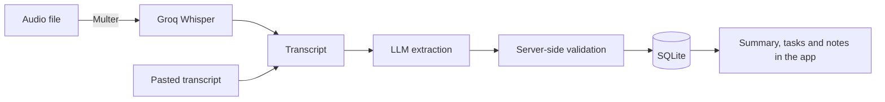
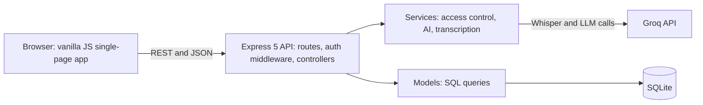
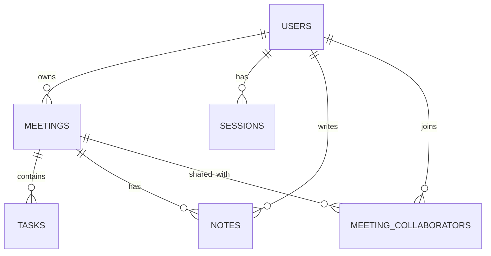

# MeetingAI
 
> Turn meeting recordings and transcripts into summaries, decisions, and action items. Then share them, protect them, and keep track of what actually gets done.

 After a meeting, the notes end up buried in someone's notebook and the action items quietly get forgotten. MeetingAI fixes that. Upload a recording or paste a transcript, and it produces a summary, key points, decisions, and a task list. You can track the tasks, share the meeting with teammates, and lock sensitive meetings behind a PIN.

 
 


 
## Table of contents
 
- [Features](#features)
- [How it works](#how-it-works)
- [Roles and permissions](#roles-and-permissions)
- [Security and design decisions](#security-and-design-decisions)
- [Tech stack](#tech-stack)
- [Project structure](#project-structure)
## Features
 
**AI processing**
- Upload an audio file (`.mp3` or `.wav`) or paste a transcript.
- Audio is transcribed with Groq's Whisper; a language model then extracts a summary, key points, decisions, and action items (title, assignee, deadline, priority).
- The model's JSON output is validated on the server before anything is saved. Malformed action items are dropped and unknown priorities fall back to `medium`, so a bad response can't corrupt the database.
**Meetings**
- Every meeting gets a readable code like `MTG-2026-0001`, plus a title, date, participants, and description.
- Search by title, code, or participant. Archive and restore, edit details after processing, or delete for good.
**Tasks and notes**
- Tasks have a priority and a status. Mark them done, reopen them, edit them, or delete them. Filter by status, priority, or meeting, and search by title.
- Add notes to any meeting, pin the important ones, and see who wrote each note. A global Notes page lets you search across everything.
**Collaboration**
- Invite people to a meeting by email (they need an account) as an **editor** or a **viewer**.
- Change roles, remove people, or leave a meeting someone shared with you. Shared meetings appear on a "Shared with me" page.
**Vault**
- Protect a meeting with a PIN. Vaulted meetings disappear from lists, search, and dashboard counts, and can only be opened by entering the PIN.
**Dashboard**
- Live counts of meetings and tasks, your recent meetings, and a quick-create box for pasting a transcript straight from the home screen.
## How it works
 

 
1. **Input.** You upload audio or paste text. Pasted transcripts skip speech-to-text entirely.
2. **Transcription.** Audio goes to Whisper and comes back as plain text.
3. **Extraction.** The transcript goes to an LLM with a strict prompt that asks for JSON only and tells it not to invent assignees, deadlines, or participants.
4. **Validation.** The server checks every field of the response before trusting it.
5. **Storage.** The meeting, its summary, and its tasks are saved to SQLite in one request.
The request stays open while this runs, so long recordings take a little while.
 
### Architecture
 

 
The backend is layered so each file has one job: routes map URLs to controllers, middleware handles authentication and access checks, controllers handle requests and responses, services talk to Groq and decide permissions, and models are the only place SQL is written.
 
### Database
 

 
Six tables, with foreign keys switched on and `ON DELETE CASCADE`, so deleting a meeting also removes its tasks, notes, and collaborator entries. The schema is created automatically the first time the server starts.
 
## Roles and permissions
 
| Action | Owner | Editor | Viewer |
|---|:---:|:---:|:---:|
| View the meeting, tasks, and notes | ✅ | ✅ | ✅ |
| Edit title, date, participants, description | ✅ | ✅ | ❌ |
| Edit or complete tasks | ✅ | ✅ | ❌ |
| Add notes | ✅ | ✅ | ❌ |
| Edit or delete notes | Any note | Own notes only | ❌ |
| Archive, restore, or vault the meeting | ✅ | ❌ | ❌ |
| Delete the meeting | ✅ | ❌ | ❌ |
| Invite people and manage roles | ✅ | ❌ | ❌ |
| Leave the meeting | n/a | ✅ | ✅ |
 
A vaulted meeting is visible to its owner only, and only after unlocking it. For collaborators it simply does not exist.
 
## Security and design decisions
 
- **Passwords** are hashed with bcrypt. Password and PIN hashes are never included in any API response.
- **Access tokens** are short-lived (15 minutes) JWTs kept only in JavaScript memory, never in `localStorage` or `sessionStorage`.
- **Refresh tokens** last 7 days and live in an `httpOnly` cookie that page scripts cannot read. Only a SHA-256 hash of each one is stored in the database, so logging out genuinely revokes the session on the server. The frontend refreshes silently when an access token expires.
- **One place decides permissions.** Every meeting, task, and note route asks the same access service what role the user has. People with no access get a `404` rather than a `403`, so nobody can probe which meeting IDs exist.
- **The vault is a second lock on top of login.** PINs are bcrypt-hashed. A correct PIN returns a 10-minute token tied to one user and one meeting, signed with a separate key so it can never be used as a login token. Five wrong PINs lock that meeting's unlock for five minutes. Deleting a meeting never requires the PIN, so a forgotten PIN can't trap data.
- **LLM output is treated as untrusted input** and validated before it reaches the database.
- **Other basics:** SQL uses bound parameters, user-provided text goes through an HTML-escaping helper before it is rendered, and input is validated on the server rather than trusting the frontend.
## Tech stack
 
| Layer | Technology |
|---|---|
| Frontend | HTML, CSS, vanilla JavaScript (ES modules), a small History API router |
| Backend | Node.js, Express 5 |
| Database | SQLite via `better-sqlite3` |
| AI | Groq: Whisper for speech-to-text, an LLM for extraction |
| Auth | JWT, bcrypt (`bcryptjs`), httpOnly cookies |
| Uploads | Multer |
| Icons | Tabler Icons |

 ## Project structure
 
```text
Meeting-AI-Dashboard/
├── client/
│   ├── public/         Landing, login, and signup pages
│   ├── app/            Single-page app: router and views
│   └── shared/         API helper, auth state, vault tokens, modals, design tokens
├── src/
│   ├── config/         Database connection and schema
│   ├── controllers/    Request handlers
│   ├── middlewares/    Authentication, access checks, file upload
│   ├── models/         All SQL queries
│   ├── routes/         URL to controller mapping
│   ├── services/       AI extraction, transcription, access control
│   ├── utils/          Token helpers and vault attempt tracking
│   ├── validators/     Input validation
│   ├── app.js          Express app setup
│   └── index.js        Server entry point
├── nodemon.json
└── package.json
```

